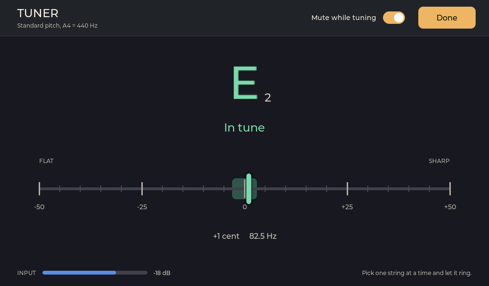
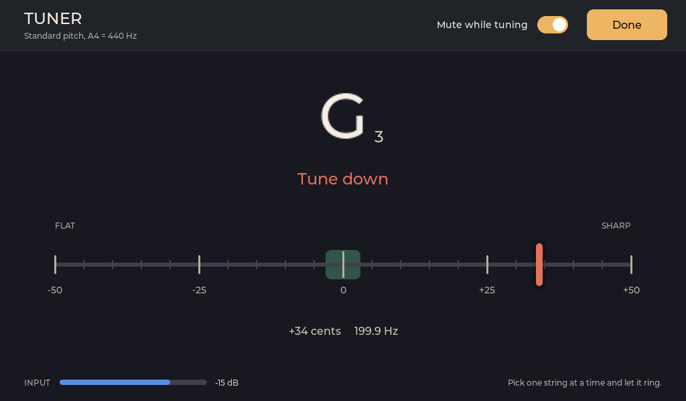

# Tuner

A tuning mode on the touchscreen: pick one string, and the page shows the note, how many cents sharp
or flat it is, and which way to turn. The Seed listens to the guitar (only it has the audio); the
touchscreen only shows what it hears.

*Rendered on a Mac from the page's own code (`ui_tuner.c`, LVGL, the app's dark theme) with simulated
readings; not yet photographed on the panel.*

## Using it

**Tuner** in the bottom bar (full UI and "Seed controls only" alike) opens it. The button appears
only when the Seed reports it has a tuner, so with a Seed build without one it isn't there. **Mute
while tuning** (on by default) silences the amp's output while the page is open. **Done** closes it.

- The needle turns green within +-3 cents ("In tune"), amber within 15, red beyond; "Tune up" /
  "Tune down" says which way.
- The big letter is the nearest note with its octave (the low E string is E2), A4 = 440 Hz.
- INPUT at the bottom shows the guitar's level as the Seed hears it: a still bar means the guitar
  isn't reaching the Seed, not that the tuner is broken.
- When the string fades, the last note stays up for 0.6 s in grey: still readable, plainly not live.

## How it works

| Where | What | Cost |
|---|---|---|
| Seed, audio callback | Only while the page is open: the guitar's input (before any effect) through a 30 Hz high-pass and a 5 kHz anti-alias low-pass, into a ring | 0.25 us per block on a Mac; a few us on the Seed, under 0.5 % of the budget |
| Seed, main loop | The pitch, 20 times a second (`seed-dsp/tuner.cpp`) | about 0.35 ms on a Mac; not in the audio callback, so not in the DSP load and never a dropout |
| Link | `SET_TUNER` (page open/closed, mute; repeated each second) and `TUNER` (pitch, level, clarity; 20 a second): [SEED_LINK_PROTOCOL.md](SEED_LINK_PROTOCOL.md) | about 300 bytes a second |
| Touchscreen | Median of the last five readings, needle easing, the note held 0.6 s after the string fades (`firmware/main/ui/tuner_note.c`); the page (`ui_tuner.c`) | built when opened, deleted when closed |

The detector is two passes over the newest 40 ms (see `seed-dsp/tuner.h`): YIN at 24 kHz finds the
period without octave errors, then the raw difference at the full 48 kHz around it gives the exact
pitch. Both read the whole waveform, as clip-on, pedal and phone tuners do. A real string's upper
partials run a little sharp (inharmonicity), so on the low E and G this reads a few cents above the
fundamental alone, which is what players tune to.

**Tested against a reference tuner (2026-11-17).** The first version low-passed pass 2 down to the
fundamental. With the guitar tuned to a reference, it read E2 -8, A2 -1, D3 -3, G3 -7, B3 -3 and E4 -1
cents: flat, most on the two most inharmonic strings. Two causes, both fixed: the low-pass (pass 2 now
reads the whole waveform, which on synthetic strings reads +3 to +6 cents over the fundamental of a
typical low E), and the Seed's clock. libDaisy's PLL3 (16 MHz / 6 * 295 / 16 = 49.167 MHz) through
the SAI's divide by 1024 makes the audio rate 48014.3 Hz, not the 48000 it reports, which read every
string 0.52 cents flat; the Seed now tells the detector its true rate.

If the touchscreen stops repeating `SET_TUNER` for 2.5 s (a reset, a pulled cable), the Seed turns the
tuner off and lifts the mute itself, so the amp can't stay silent.

## Accuracy (`bash seed-dsp/test.sh`, synthetic plucked strings)

| Case | Result |
|---|---|
| Every string, drop D, drop A (55 Hz), a 7-string's low B, up to the 24th-fret E (1319 Hz) | within 0.16 cent |
| Detuned 1 to 45 cents either way | within 1 cent |
| Low E with the fundamental at a tenth of the second partial (a bridge pickup) | no octave error |
| Inharmonic low E strings (B = 0.00005 to 0.0003) | +2.9 to +15 cents over the fundamental alone, as the whole waveform reads; wandering by 0.8 to 2.1 cents as the partials drift out of step (other tuners see the same; the page's smoothing absorbs it) |
| The Seed's 48014.3 Hz clock | 0.52 cents flat uncorrected, 0.001 corrected |
| A plucked string decaying over 2 s, noise 70 dB down | a reading throughout, all within 1 cent |
| Moving straight to the next string | settled within 0.01 cent from 200 ms after |
| Silence, white noise, a note under -75 dBFS | no note (a guitar arrived at -50 to -58 dBFS on the amp board, silence at -102) | The page's arithmetic and the two messages (round trips,
fuzzing, the Seed's receiver) have host tests too: `bash tools/run_host_tests.sh`.

## Builds and files

The tuner is in the Seed's effects build only (`make link-fx` in `seed/`): the demo build
(`make link`) has 28 bytes of internal flash left. It compiles the receiver's `SET_TUNER` hook only
with `SLP_RX_TUNER`, so the demo build is byte-identical to before.

| File | |
|---|---|
| `seed-dsp/tuner.{h,cpp}`, `seed-dsp/test_tuner.cpp` | the detector and its tests |
| `seed/src/main.cpp` (`SEED_FX`) | feeding it, `SET_TUNER`, the mute, `TUNER` frames, the 2.5 s timeout |
| `firmware/main/seed_link_proto/` | the two messages and the `HAS_TUNER` status bit |
| `firmware/main/seed_link.{h,c}` | `seed_link_set_tuner`, `seed_link_get_tuner` |
| `firmware/main/ui/ui_tuner.{h,c}`, `tuner_note.{h,c}` | the page and its arithmetic |
| `tools/slp.py`, `tools/mock_seed.py` | the messages in Python; the mock Seed simulates tuning each string in turn |

The note's font is Montserrat 48 at 2x, which needs `CONFIG_LV_FONT_MONTSERRAT_48=y` (in
`sdkconfig.defaults`; an existing `sdkconfig` needs it set in menuconfig, else the page falls back to
the 24 px font at 4x, softer).

## Not done yet

- Rechecked against the reference tuner after the fixes (2026-11-17): every string matches.
- A4 is fixed at 440 Hz; no drop/alternate tuning presets (the page names the nearest note, so any
  tuning works).
